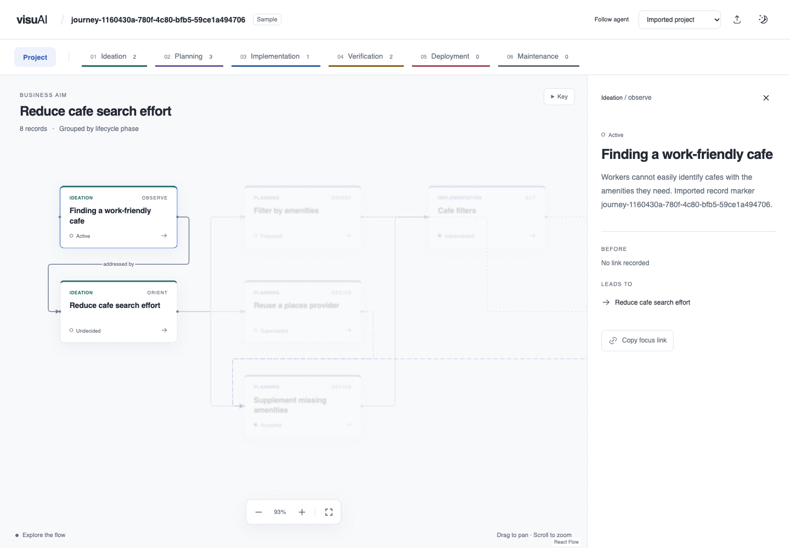

# Exporter and viewer journey trial

The [project recipe](verify-project-flow/SKILL.md) is the runnable entry point. It demonstrates [Exercise user journey](../../../skills/verification/exercise-user-journey/SKILL.md) and [Maintain user journeys](../../../skills/maintenance/maintain-user-journeys/SKILL.md) on the actual exporter CLI and React viewer.

The three mapped features export synthetic records, import the resulting file and inspect its summary, and reject malformed input while preserving the imported data. A per-run marker in the inspected record distinguishes fresh exported content from the bundled sample.

## Recorded results

| Run | Result and evidence |
|---|---|
| Author | All three passed, owned server/browser closed. [Summary](evidence/author/summary.json), [CLI output](evidence/author/export-command.json), [browser trace](evidence/author/trace.zip) |
| Independent maintenance | Seeded stale navigation was corrected in a copied recipe after source and live inspection. All three final journeys passed. [Report](evidence/maintenance/maintenance-report.md), [final summary](evidence/maintenance/final-strengthened/summary.json), [correction](evidence/maintenance/recipe.diff) |
| Injected stale-summary regression | A temporary checkout replaced the imported summary with demo text. The journey failed at the exact summary assertion, with cleanup completed. [Summary](evidence/regression/summary.json) |
| Missing browser prerequisite | Incomplete, nonzero exit, no false success. [Summary](evidence/missing-browser.json) |

The preserved raw logs contain original local paths and capture times. Files are copied here under the corresponding run folder, including the source fixture, snapshot, browser screenshots and trace. They are historical evidence, and rerunning the recipe creates a new result directory. Author manifest hashes refer to retained files relative to the author directory.

Product revision a21d337 was inspected with local skill/helper changes. Relevant source hashes, runtime versions and working state are in the summaries. Scope, setup findings, review corrections and limits are recorded in the [validation record](../../proposals/user-journey-verification.md).
