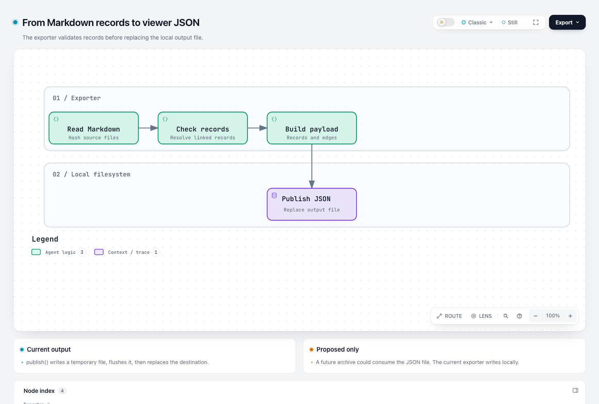

# Proposal to use Archify for requested system diagrams

## Change and lifecycle process

Give [Understand system](../../skills/implementation/understand-system/SKILL.md) in Implementation an optional handoff to the upstream Archify skill. Link to that handoff from [Set development direction](../../skills/planning/set-development-direction/SKILL.md) for diagrams of a proposed design. Perry requested implementation and publication on `first-iteration-1.1`. The branch adds [Diagram system](../../skills/implementation/diagram-system/SKILL.md) as the canonical skill entry point. Independent maintainer review is pending.

## Problem and need

A maintainer asks, “Show me how the workflow exporter turns project records into viewer data.” Understand system already traces entry points, transformations and outputs. It supplies the facts, but gives no handoff for a reader who explicitly wants a shareable diagram. Planning has a different use for the same tool when a maintainer asks how a proposed boundary would change that flow.

## Proposed solution and scope

Follow the existing [specialist handoff](../workflows/deliver-change.md#bring-in-a-specialist-when-the-work-needs-one). Pass the bounded question, inspected revision, source references and unresolved boundaries to the published `archify` skill. For a design, identify proposed relationships explicitly. Return the standalone HTML alongside the underlying explanation.

Both lifecycle entry points link to Diagram system. Upstream maintains its renderer and supporting assets. The four skills under upstream’s `.agents/skills/` support maintenance of Archify itself. Importing them, changing the project viewer and requiring diagrams throughout the lifecycle are outside this proposal.

## Alternatives and tradeoffs

A short source-linked explanation is usually enough. Use Archify when the reader asks for a visual artifact. Copying the upstream package would allow offline distribution but would make this project responsible for renderer updates, assets and license notices. Revisit distribution if repeated trials identify installation as a barrier.

## Tools and services

The proposed route uses an available Archify distribution, Node.js 18 or later, a supported browser for the delivery check, local read access to selected source and write access to an output folder. The upstream finalization command includes an update check. Use a local output path, omit sensitive values, and review the diagram before sharing. The proposed trial requires no paid service. If the renderer or browser is unavailable, deliver the source-linked trace and identify the outstanding artifact or check.

## Acceptance criteria and validation

- [x] For the exporter question, trace one input through `scripts/export_workflow.py` to its output at a recorded revision. Produce a standalone diagram, open it, and check its materially important arrows against the cited source. Record Archify’s finalization result.
- [x] For a proposed exporter boundary, label it as proposed and keep the existing flow distinguishable. A reader can tell which part exists today.
- [x] With a missing source or unavailable renderer, name the gap and return the supported explanation. An ordinary text-only request completes without starting Archify.

### Exporter walkthrough

At `47410812e0dad5af068d5872097b13bf8298775e`, the exporter reads and hashes Markdown, checks records and resolves links, builds the viewer payload, then publishes JSON through a temporary file and an atomic replace. The [diagram input](../examples/archify/export-workflow.json) cites the relevant lines in `scripts/export_workflow.py`. The archive appears only in a card labeled “Proposed only.”



To reproduce from the repository root, set `ARCHIFY_CLI` to the pinned distribution’s absolute `bin/archify.mjs` path. Run:

```sh
repo=$(git rev-parse --show-toplevel)
trial_dir=$(mktemp -d)
(cd "$trial_dir" && node "$ARCHIFY_CLI" finalize workflow "$repo/docs/examples/archify/export-workflow.json" export-flow.html --repo-root "$repo" --quality showcase --json)
```

Archify 3.2.0 passed validation, delivery, strict artifact checks and the real-browser check. Visual inspection in Chrome confirmed three readable arrows ending at the local JSON file. Its default legend uses generic role labels. Code inspection checked the depicted relationships against the cited revision.

A separate read-through exercised both lifecycle entry points before and after the change. The original entries stopped at a Markdown explanation or planning brief. The new route keeps text-only requests in Understand system, returns a sourced explanation when the renderer is unavailable, marks missing evidence, and reports any failed browser check with draft status. Those fallback cases were scenario checks.

## Ownership and dependencies

Branch owner: Perryong. Suggested reviewer: ChouBokYann. Agent contributions cover the skill, its two lifecycle handoffs, their indexes and the exporter walkthrough. [Issue #7](https://github.com/ChouBokYann/visuAI-DLC/issues/7) covers the three-source comparison. [Issue #11](https://github.com/ChouBokYann/visuAI-DLC/issues/11) defers broader visualization work. Neither records acceptance for this external specialist.

## Sources, impact and risks

Reviewed [Archify 3.2 at a7ed6fd](https://github.com/tt-a1i/archify/tree/a7ed6fd6657da90414831d1d42cf95987188750c/archify), published under Apache-2.0 with bundled notices. An attractive diagram can imply more certainty than the trace provides. Keep source references and qualify unverified paths. Removing the skill and its handoff and index links would restore the previous routing.

## Open question

Does the exporter trial justify selecting this optional specialist for the shared library?
