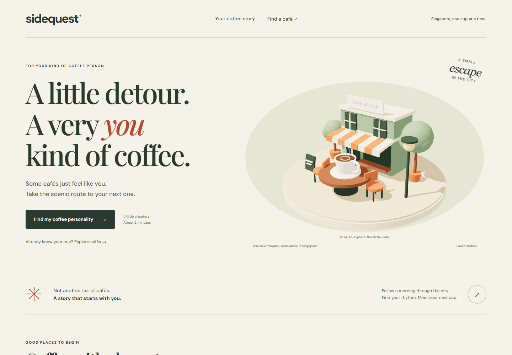
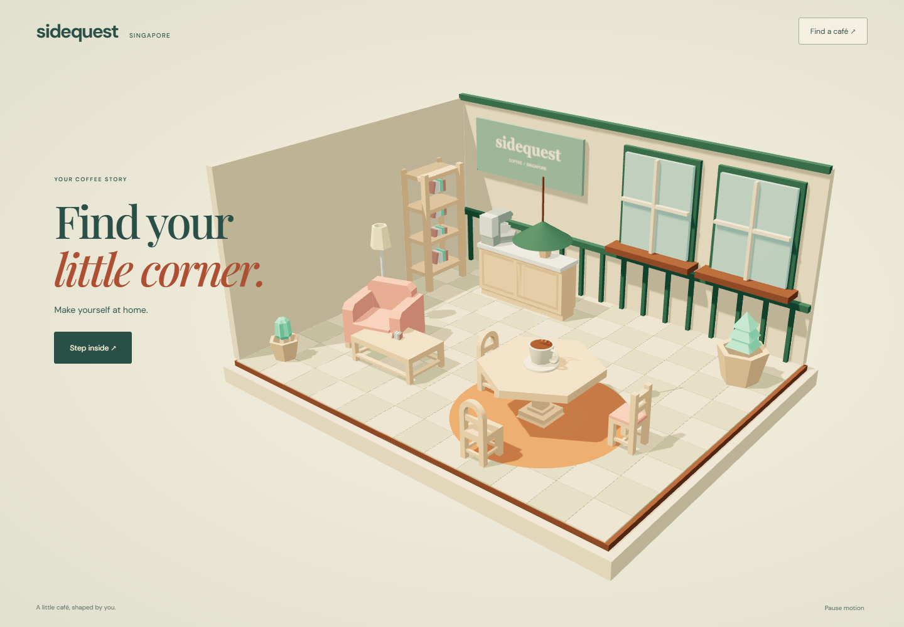
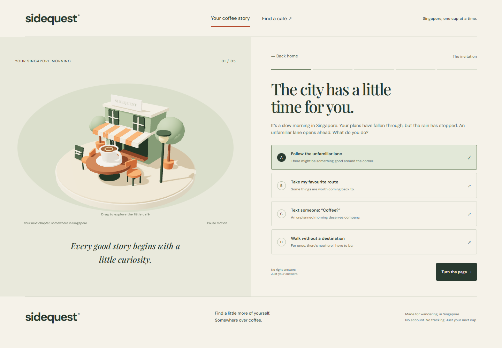
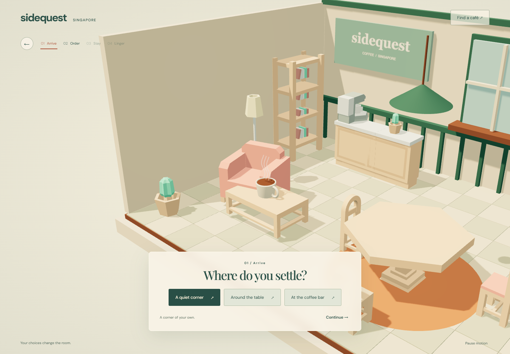
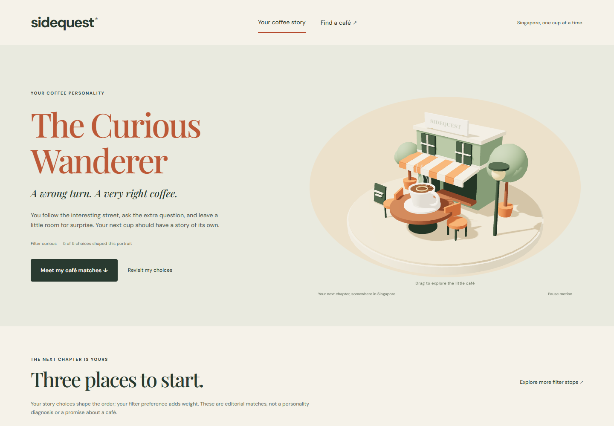
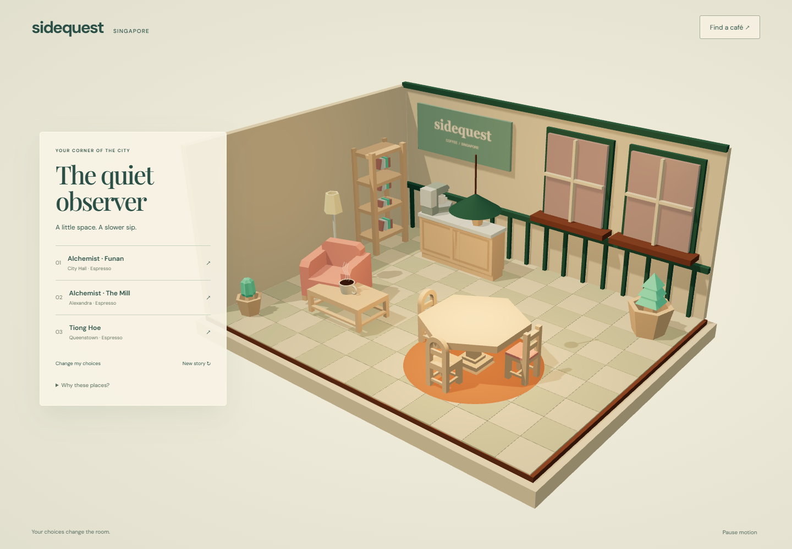
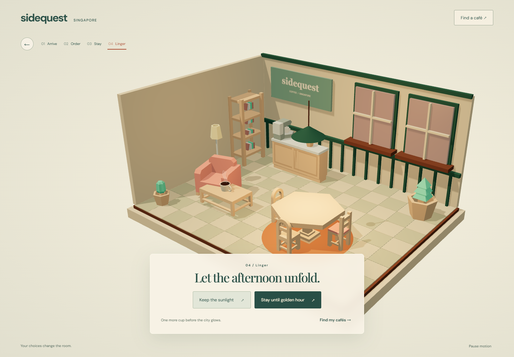

# Cafe experiments: what changed

The retry better matched the requested experience: short choices shape a furnished 3D cafe instead of a long questionnaire beside a model. The user found it much better and broadly what they wanted, with artistic direction still lacking. This is an informed retry, not a controlled benchmark.

| | Experiment 01 | Experiment 02 |
|---|---|---|
| Product | Five-step prose-led story beside a 3D cafe model | Four-step story inside a responsive furnished cafe |
| Interaction | Questionnaire leads to personality and cafe picks | Seat, drink, company and daylight choices affect the scene, then lead to picks |
| Shared function | Personality matching and independent coffee search | Same core brief; editable choices and independent search retained |
| User judgment | Rejected: wordiness, artifacts and animation | Much better; broadly intended experience; artistic direction still a gap |
| Tokens | 97,974 host aggregate through technical completion | Unavailable; no new host counter |
| Time | 17m 30s host goal interval | 15m 49s to author checks; 17m 30s through handoff |
| Technical evidence | 5 logic cases and 7 browser scenario groups passed | 5 logic cases including 36 answer combinations; browser journeys and motion samples passed |

**Token savings: unknown.** Run two has no measured token total. We cannot calculate a token reduction, cost saving or per-skill efficiency. Its time includes overlapping archive/setup and asset acquisition, whereas run one's interval is host goal accounting. Even though both handoff/technical totals are 17m 30s, these are different measurement boundaries and do not establish equal effort or savings. Later feedback, framework changes and this comparison are outside those totals.

The workflow improvement was to preserve requested quality as baseline requirements, inspect a representative scene early, and separate functional tests from user acceptance. The retry also benefited from a clearer user-selected direction, reused cafe facts/functions/dependency lock, and consistent licensed Kenney furniture. These factors prevent attributing the improvement solely to the workflow. The later external design-specialist routing change has not yet been tried on the product; it did not cause the observed improvement. Neither trial invoked perfect-it.

## Fresh screenshots

Captured at the same 1440 x 1000 viewport in isolated Chromium with reduced motion for settled stills. Original evidence is untouched. These paths illustrate each experience; answers are not an identical semantic control. Capture time, states and hashes are in [captures.json](captures.json); [capture.mjs](capture.mjs) reproduces them with both local servers running. Both freshly captured journeys reached three cafe matches; this was not a repeat of the full suites.

| State | Experiment 01 | Experiment 02 |
|---|---|---|
| Home |  |  |
| Story |  |  |
| Result |  |  |

### Choice changes the room

Screenshots cannot demonstrate animation quality. The retry's earlier [journey recording](../cafe-personality-v2/evidence/journey.webm) and [timed motion observations](../cafe-personality-v2/evidence/browser-observations.json) retain that evidence; physical-device smoothness is untested.

## Final product limits

Both are local demos with six curated Singapore locations, editorial matching, and no live comprehensive cafe database or public deployment. User completeness was not separately rated. Positive feedback is not blanket artistic approval or measured business benefit. Physical mobile performance and Safari/Firefox remain untested.

Sources: [first accounting](../cafe-personality/trial-metrics.json), [first report](../cafe-personality/EXPERIMENT.md), [retry accounting](../cafe-personality-v2/trial-metrics.json), [retry decision record](../cafe-personality-v2/records/experiment.md).
