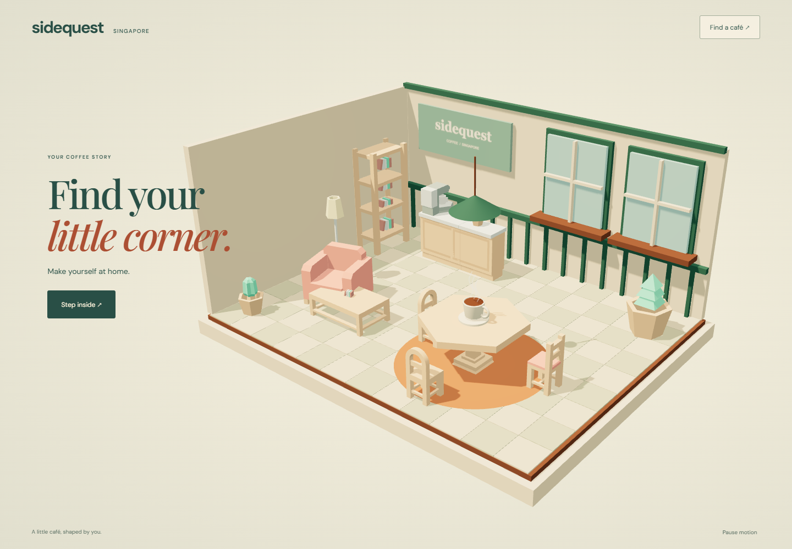
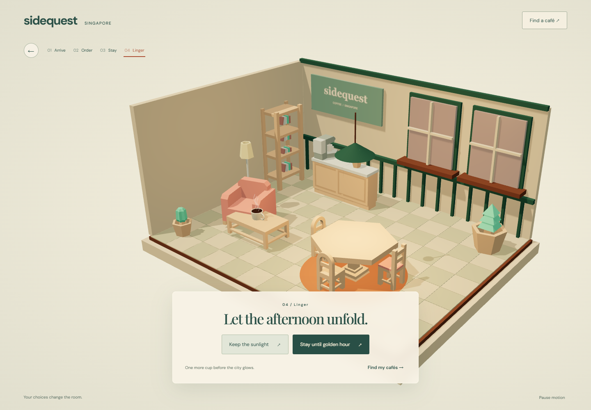
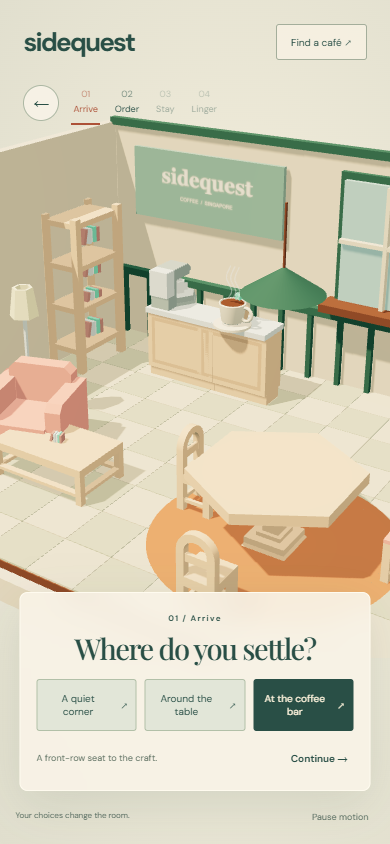

# Experiment 02 ? Sidequest, a responsive caf?

**User reviewed: much better, with an artistic-direction gap.** This retries the original caf? brief using workflow revision e677e0c and the user's selected stylized exploration direction. The first experiment is preserved separately.

- [Open the new experiment](http://127.0.0.1:5175)
- [Original experiment and judgment](../cafe-personality/EXPERIMENT.md)
- [Expectations, requirements and evidence](records/experiment.md)
- [Separate accounting](trial-metrics.json)
- [Recorded journey](evidence/journey.webm)

## What to try

Step inside. Choose a seat, order a coffee, invite company, then change the daylight. Revisit an earlier choice to see the room respond. Browse caf?s independently through the top-right button. Your review found this broadly the intended experience, with artistic direction still lacking. Completeness was not separately rated; no perfect-it pass was run.

## Run and verify

```powershell
npm ci
node node_modules/vite/bin/vite.js --host 127.0.0.1 --port 5175 --strictPort
```

`npm test` covers all 36 story combinations and search behavior. `npm run build` type-checks and builds. `npm run test:browser` needs the running server plus Playwright Chromium and FFmpeg (`node node_modules/playwright/cli.js install chromium ffmpeg`). Set PLAYWRIGHT_CHROMIUM_EXECUTABLE_PATH to reuse a compatible local Chromium. Tests use isolated profiles and save screenshots/video to evidence/. [verification-state.json](verification-state.json) identifies the checked source.

## Visualization

Import [public/workflow.json](public/workflow.json) in the [existing viewer](http://127.0.0.1:5173), then enable Follow agent. The published story explains what changed in requirement translation. The viewer does not directly read this chat and no claim is made that an existing personal-browser tab was changed.

## Evidence gallery





See the [motion recording](evidence/journey.webm), [pour midpoint](evidence/pour-midpoint.png), [desktop result](evidence/result-desktop.png), [mobile result](evidence/result-mobile.png) and [search](evidence/search-desktop.png). Still images alone do not establish animation quality.

## Reuse and limits

Original caf? facts, filtering/map-link functions and dependency lock were reused. Scene/UI and matching were rewritten. Furnishings are Kenney CC0 assets from a pinned public mirror; [source](public/models/SOURCE.txt) and [license](public/models/LICENSE.txt) are included. Downloaded assets are served locally, not from the mirror at runtime. Google Fonts is fetched externally with system fallback. Answers remain in sessionStorage; no backend or analytics.

Five logic cases and browser journeys passed. Author inspected representative asset placement, motion frame sequences and mobile views. User feedback is positive with an artistic-direction gap; real-device performance and Safari/Firefox remain unverified. Token usage for this retry is unavailable because no new host goal counter was supplied; prior-run totals are not reused. This informed retry is not a controlled benchmark.

See the [two-run comparison and fresh screenshots](../cafe-comparison/README.md) for product changes and accounting limits.
