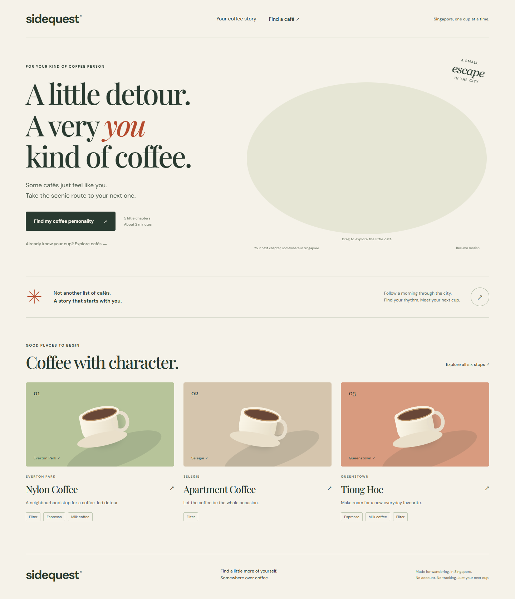
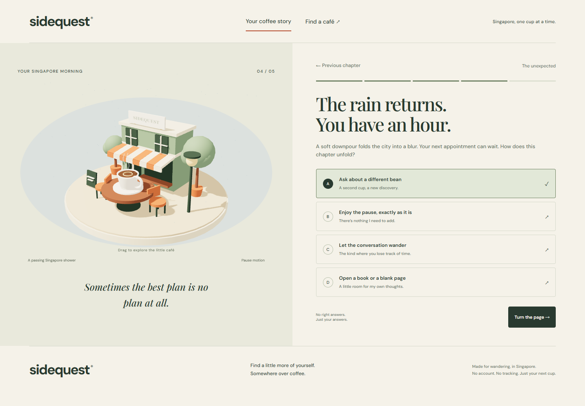
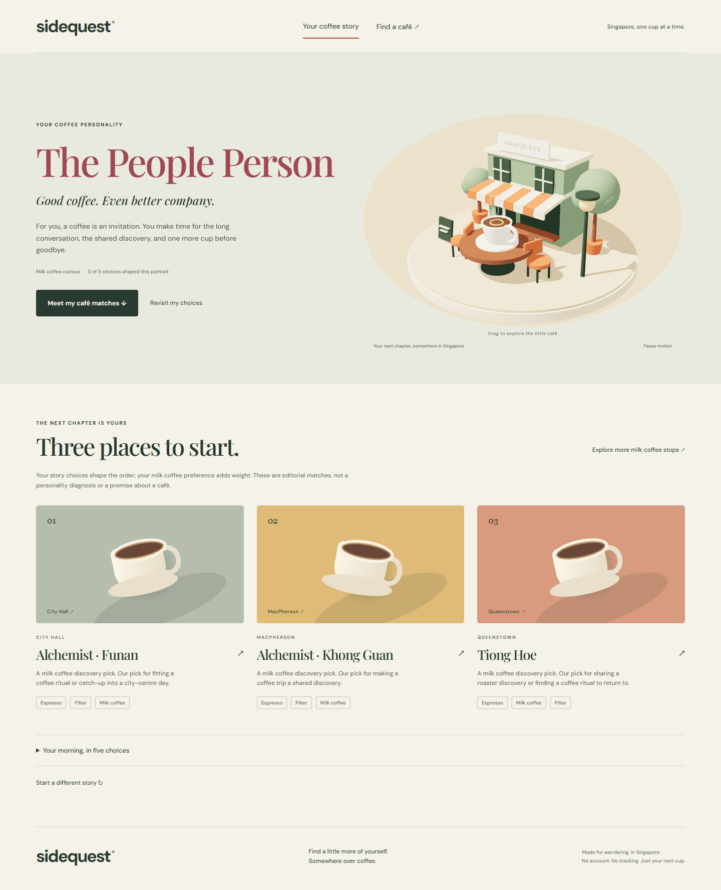
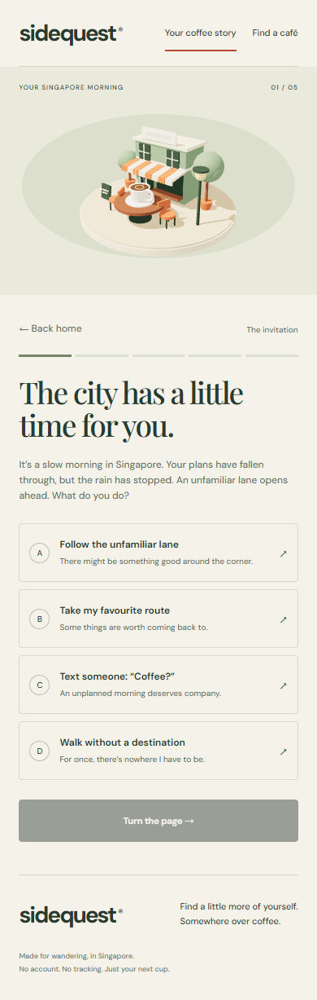
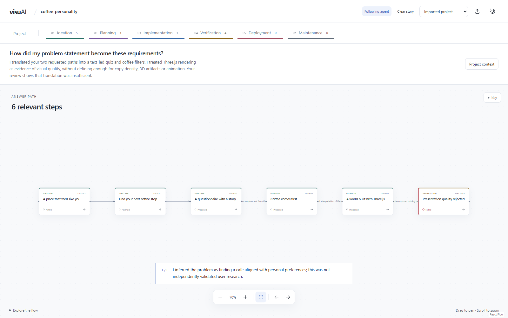

# Experiment 01 ? Sidequest

**Outcome: functional delivery, rejected presentation quality.** This is the preserved first attempt, not the improved version. User judgment: too many words, poorly executed 3D artifacts, and little or no good animation. Overall completeness was not separately rated.

## Brief and conditions

Build a React website to find Singapore cafes by personality, with a storytelling questionnaire and coffee-focused search. Three.js was explicitly the main design principle; the user selected a polished portfolio demo. The existing preference for fewer words should have informed requirements.

Workflow at implementation: first-iteration `319c169`, before the expectations-to-done correction in `e677e0c`. App source is identified by [verification-state.json](verification-state.json). Actual skill usage and decisions are preserved in [the trial record](records/trial.md). No perfect-it pass or independent agents were used.

## Measurements

| Measure | Recorded result |
|---|---|
| Host aggregate tokens through technical completion | 97,974 |
| Host elapsed time | 17m 30s |
| Logic tests | 5 passed |
| Browser scenario groups | 7 passed |
| Visualization integration | Passed in isolated Chromium |
| User quality judgment | Rejected |
| User completeness judgment | Not supplied |

See [raw accounting](trial-metrics.json). This is host accounting, not an invoice or per-skill attribution. Later feedback, archiving and workflow changes are outside that run's totals. There was no control run; neither low cost nor workflow efficacy is established by these results.

## What failed

- The agent equated a functioning Three.js scene with adequate visual quality.
- Storytelling was mostly prose; copy restraint lacked a concrete acceptance check.
- Animation was not assessed with evidence appropriate to motion quality.
- Agent elaborations initially appeared as accepted requirements; the reviewed record now identifies them as proposals.
- Passing technical checks did not justify implying that the polished-demo expectation was met.

The framework response is recorded in [expectations-to-done](../../docs/proposals/expectations-to-done.md): preserve expectation-to-requirement links, evaluate representative experience slices, and distinguish functional checks, quality and user acceptance.

## Screenshots

Original verification captures are preserved unchanged. The final workflow screenshot is a later capture of the user-reviewed record. See [capture manifest](evidence/manifest.json) for file hashes and provenance. Screenshots do not establish animation quality.

### Desktop home

### Story interaction

### Result

### Mobile story

### Requirement translation and user judgment

Additional captures: [mobile home](evidence/screenshots/home-mobile.png), [mobile search](evidence/screenshots/explore-mobile.png), [original delivery workflow](evidence/screenshots/workflow-story.png).

## Comparison protocol

Keep this app unchanged. Experiment 02 repeats the same brief using the improved workflow and the user's selected direction: a stylized cafe exploration with a characterful space that changes with choices. Reuse sourced cafe facts where appropriate, disclose code/assets reused, and isolate the new implementation and measurements. The user again owns quality and completeness judgments. Learning from this first run means the comparison is not blinded or controlled.
