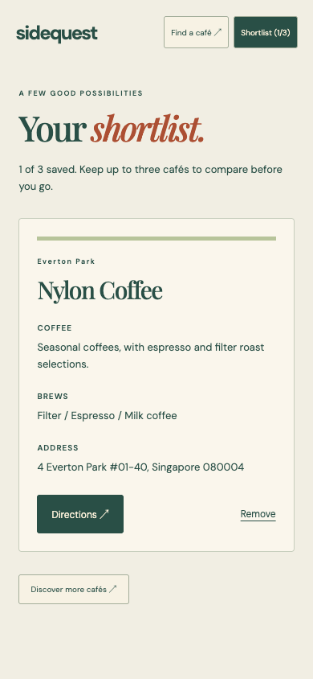

# Experiment 05 — coordinate a shortlist persistence repair

**Verified within the local experiment scope.** A fresh coordinator used the new [Coordinate agent work](../../skills/implementation/coordinate-agent-work/SKILL.md) skill to route an independently observed defect through one implementation owner and back to the same reviewer. Previous experiments are unchanged.

## What was tested

The new app is copied from Experiment 03 at `6f78181`. A deliberately seeded early return made writing an empty shortlist report success without updating storage. Removing the final café appeared to work, but refreshing restored it. This was an artificial fixture, not a defect discovered in the earlier delivered experiment. [Seed provenance](seed.json) · [Seed patch](evidence/seed.patch) · [Frozen criteria](records/brief.md).

The experiment asks whether the skill can support a concrete assignment, truthful evidence, one writer, finding-to-fix handoff, independent retest and integration/cleanup. It does not measure a general advantage over other workflows.

## Observed result

| Check | Seed / before repair | Corrected result |
|---|---|---|
| Original unit suite |8/8 passed, missing this regression|9/9 passed after adding regression coverage|
| Focused new assertions |0/2 passed: stale saved IDs and false success on denied empty write|Same assertions 2/2 passed|
| Independent primary browser assertions |6/16 passed; 10 failed at desktop/mobile|Same 16 assertions passed|
| Independent extended browser coverage |Reserved for corrected candidate|68/68 total checks across 8 scenarios|
| Existing shortlist journey suite |Not used to establish the seed failure|7/7 scenarios passed|
| Production build |Not evidence of the seed behavior|Passed; inherited large Three.js chunk warning|
| Cleanup |Each seed attempt preserved|Owned Vite/Chrome processes and temporary profiles removed; evidence retained|

The raw observations establish 68 corrected checks; an intermediate coordinator message said 66 and was corrected against those logs. The 68 include the original 16. Checks within scenarios are not 68 independent experimental trials.

The repair removes the empty-array early return, letting the existing storage write and error handling run for every selection size. Only `app/src/shortlist.ts` and `app/src/shortlist.test.ts` differ from the seeded product source. [Repair patch](evidence/integration/seed-to-candidate.patch) · [Author red/green record](evidence/author/repair.md) · [Independent review](evidence/reviewer/review.md) · [Final validation](evidence/final-validation.json).

## How the agents interacted

```mermaid
sequenceDiagram
    participant P as Perry / root
    participant C as Fresh coordinator
    participant R as Independent reviewer
    participant W as Implementation owner
    P->>C: New skill, bounded task, frozen criteria and new app
    C->>R: Read-only seed review; owned browser and evidence
    R-->>C: E05-R-01 reproduced on desktop/mobile
    C->>W: Finding, exact source, two-file write grant
    W->>W: Observe failing regression; repair; same test passes
    W-->>C: Source hashes, patch, 9 passing tests; release ownership
    C->>R: Frozen corrected source; same finding and criteria
    R-->>C: E05-R-01 resolved; 68/68 browser checks
    C->>C: Verify integrated source, build, existing journeys and cleanup
    C-->>P: Verified local result with preserved evidence
```

Actual identities: `/root/coord_bugfix_run`, its `/reviewer` and `/author` children. Root authored the skill and consolidated the report. A separate `/root/coord_skill_review` reviewed the skill/navigation, not the app. [Coordinator ledger](records/coordination.md) · [Author assignment](records/dispatch-author.md) · [Reviewer assignments](records/dispatch-review.md).

This was a genuine initial-review → repair → independent-retest loop. The author fixed the defect in one repair. No additional failed repair was manufactured. Source was frozen and identified at each handoff; author and reviewer had separate write ownership.

## What the skill review changed

The skill follows the neighboring YAML frontmatter, task-based sections, shared output-contract fallback and pinned attribution/notice format. The engineering router now links to this canonical skill instead of keeping a second assignment contract.

Independent review caught that the extracted Ownership row omitted the pinned shared-interface version/artifact. That field was restored and checked with a supplementary API/UI scenario. The proposal also now explicitly separates direct user authorization for this local candidate from the uncompleted issue-first/other-maintainer acceptance process. All skill-review findings were addressed. [Skill review and dispositions](records/skill-review.md).

## Instruction probes and limits

Five controls using the existing router and five fresh guided responses all satisfied eight frozen paper criteria. These results show compliance on the supplied scenario, not a demonstrated improvement over the existing guidance. Discoverability is intended but was not tested through organic selection. [Probe method and outputs](skill-probes/README.md) · [Assessment](skill-probes/assessment.json).

The live coordinator initially read the probed skill; the shared-interface field was restored during the run. Both hashes and the limited revision are recorded. This trial already pinned the app contract through the frozen brief and source manifest. Do not represent it as an unchanged-skill comparison or statistical benchmark.

One seeded local defect, one host and Chromium viewport emulation do not establish general effectiveness, time/token savings, physical-device behavior or other-browser support. Browser logs retain an unidentified resource 404 and SwiftShader performance warnings; no uncaught page errors occurred. The optional machine-readable workflow export was not run because PyYAML was unavailable. Main adoption and independent maintainer acceptance remain separate from this verified local candidate.

## Evidence gallery

| After final-item removal and refresh | Seed | Corrected |
|---|---|---|
| Mobile 390×844 |  |  |

The screenshots illustrate the result; the action logs and stored-state assertions establish persistence.

## Reproduce the corrected check

From `app/`, install the locked dependencies with `npm ci`, then launch an owned server:

```sh
npm run dev -- --port 5191 --strictPort
```

In a second terminal in `app/`:

```sh
npm test
npm run build
node last-removal-browser-test.mjs replay-01 --extended
```

The reviewer helper currently targets port 5191 and the local macOS Chrome path, recorded at its top. If that port is occupied or Chrome differs, adapt those two constants in a separate copy and record the new environment; never use or stop an unknown server. Use a new attempt name for each run: it refuses to overwrite an existing evidence directory. The helper closes private browser contexts; stop the server you launched after collecting results. Replaying the seeded failure requires a separate disposable copy and the retained seed.patch; do not reintroduce it into earlier experiments.

All 265 prior tracked experiment files match the saved baseline hashes. Only the experiment navigation index gains a link. The `first-iteration` branch and old app/evidence folders are unchanged. [Preservation manifest](evidence/previous-experiments-sha256.json).
